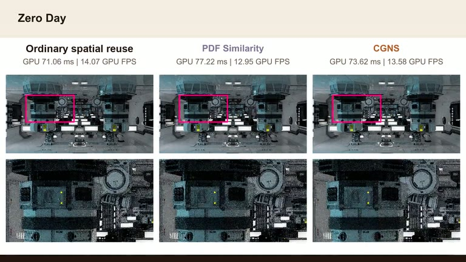

# ReSTIR Spatial Reuse: Implementation and Evaluation

This project reproduces and evaluates selected ReSTIR methods for HKUST COMP5411 Advanced Computer Graphics, taught by [Professor Pedro V. Sander](https://cse.hkust.edu.hk/~psander/).

## ReSTIR PT results

We compare ordinary spatial reuse, PDF Similarity, and CGNS on Falcor 9.0. The box in each reference image marks the region shown in all four crops.

### Emerald Square

### Bistro Interior

### Six-view statistics

All three methods use the same rendering settings at 1080p and 1 spp with temporal reuse enabled. Whole-image SMAPE is averaged over four seeds against 16,384 spp references. [Experiment settings and timing details](docs/reproductions/pt-6-views-spatial-compare.md)

| View            | Ordinary SMAPE (%) | PDF SMAPE (%) | CGNS SMAPE (%) | Ordinary GPU (ms) | PDF GPU (ms) | CGNS GPU (ms) |
| --------------- | --------------------: | ---------------: | ----------------: | -------------------: | --------------: | ---------------: |
| Emerald Square  |                 25.55 |            26.99 |         **19.74** |                    — |               — |                — |
| Bistro Interior |                 28.04 |            28.04 |         **25.30** |                37.28 |           41.33 |            38.85 |
| Bistro Exterior |                 16.67 |            16.32 |         **15.12** |                40.50 |           44.38 |            42.90 |
| Classroom       |                 17.33 |            17.19 |         **16.03** |                32.13 |           40.78 |            33.85 |
| Veach Ajar      |                 16.75 |            16.78 |         **15.89** |                22.53 |           27.22 |            23.42 |
| Zero Day        |                 19.09 |            18.74 |         **18.34** |                69.71 |           75.40 |            72.55 |

### Camera trajectory demos

Each 10-second clip shows three methods on the same camera path. Click either preview to open its MP4. [Trajectory settings](scenes/trajectories/README.md)

|                                                              Bistro Exterior                                                              |                                                Zero Day Measure Seven                                                |
| :---------------------------------------------------------------------------------------------------------------------------------------: | :------------------------------------------------------------------------------------------------------------------: |
|  |  |

## Project guide

The [ReSTIR DI baseline](results/summaries/di-baseline/README.md) evaluates Cornell Box, Arcade and Bistro using RTXDI `v3.1.0`. [PDF Similarity](docs/reproductions/pdf-similarity.md) and [CGNS](docs/reproductions/cgns.md) are available for DI. PDF's sparse evaluation is complete. The [CGNS spatial-reuse study](docs/reproductions/spatial-reuse.md) covers DI, GI and PT; retained results and their limits are documented separately.

Start with the [scope](docs/scope.md), [literature review](docs/literature/README.md), and [roadmap](docs/roadmap.md). Follow [setup](docs/setup.md) to run RTXDI, then use the [scene manifest](scenes/README.md) and [experiment protocol](experiments/protocol.md) for comparisons.

| Directory                  | Contents                                            |
| -------------------------- | --------------------------------------------------- |
| `renderers/`               | Pinned RTXDI and Falcor 9.0 submodules              |
| `scenes/`                  | Asset provenance and scene settings                 |
| `experiments/`, `results/` | Configurations and research results                 |
| `scripts/`, `tests/`       | Runners, analysis, and regression tests             |
| `docs/`                    | Plans, literature, decisions, and observations      |
| `writing/`                 | Course templates, working documents, and references |

See the [comparison workflow](docs/comparison.md) for fixed-view spatial-reuse experiments. For the six fixed Falcor ReSTIR PT views, see the [scene preparation guide](experiments/configs/falcor-pt-spatial-comparison/PREPARATION.md) and [ordinary spatial reuse / CGNS configuration](experiments/configs/falcor-pt-spatial-comparison/README.md).

Local assets, builds, and runs are ignored. Edit the [proposal](writing/course/proposal/main.tex) and [report](writing/course/report/main.tex); preserve the [original templates](writing/course/templates/README.md). The [final presentation](writing/final/README.md) includes the three-method PT comparison and trajectory demos. See [contributing](CONTRIBUTING.md), [third-party sources](THIRD_PARTY.md), and [licensing](LICENSE).

Shared Python metrics and RTXDI/Falcor saved-result readers are documented in [shared offline analysis](docs/shared-analysis.md). Existing renderer commands remain available.
