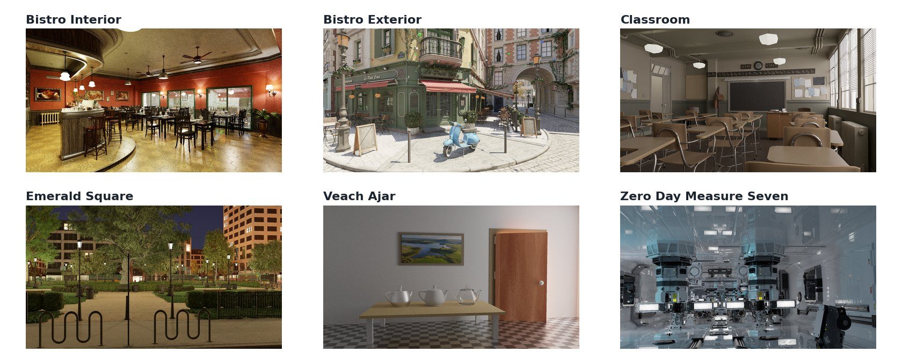
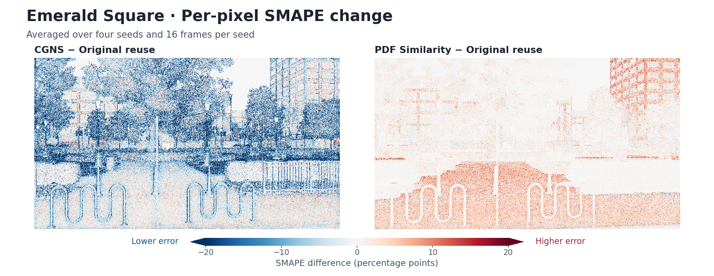

# ReSTIR Spatial Reuse: Implementation and Evaluation

This HKUST COMP5411 project compares ordinary spatial reuse, PDF Similarity, and compatibility-guided neighbor selection (CGNS) in Falcor 9.0. The earlier RTXDI experiments focus on direct illumination.

## Run the Falcor demo from source

The repository contains the renderer integration and seven scene presets. Build Falcor locally and install a scene to try the comparison. Veach Ajar is a small first download (about 9 MB) and its converter runs in Python. Start with the [Windows build prerequisites](docs/setup.md#falcor-and-live-demo).

From PowerShell in the cloned repository, run these commands.

```powershell
python -m pip install -r scripts/assets/requirements.txt
.\scripts\falcor\setup.ps1 -Jobs 4
python -B scripts/assets/install_scene.py --scene veach-ajar
.\run-demo.ps1 -Scene "Veach Ajar"
```

The first launch builds the project's demo executable from the Falcor Release build and compiles shaders as needed. Later launches reuse the local executable. In the **Graphs** panel (F6), use **Spatial reuse** to compare Original, PDF Similarity and CGNS, **Display** to switch between Raw, Accumulation and NRD, and **Scene** to switch between installed scenes in the same window. [Install Classroom and the other scenes](docs/setup.md#install-more-scenes)



The six benchmark views, shown as 16,384-spp reference renders. [Scene credits](THIRD_PARTY.md#scene-assets-and-fonts)

## ReSTIR PT results

At 1920 × 1080 and one sample per pixel, all three methods use temporal reuse and are evaluated against 16,384-spp references.

- **CGNS** achieved the lowest whole-image SMAPE in all 24 paired comparisons across six fixed views. It reduced error by 3.9–22.7% relative to ordinary reuse and added about 4–6% to GPU frame time in the five timed views.
- **PDF Similarity** reduced error by 2.1% in Bistro Exterior, nearly tied ordinary reuse in Bistro Interior, and increased error by 5.6% in Emerald Square.
- CGNS lowered temporal noise covariance and raised spatial covariance in every fixed view.



Both maps subtract original reuse pixel by pixel. Blue marks lower error and red marks higher error, with the same ±20 percentage-point display scale. [Six-view results and CSVs](results/summaries/falcor-pt-spatial-reuse/README.md)


The marked Emerald Square crop illustrates a local CGNS improvement. [Bistro Interior comparison](results/figures/bistro-interior-comparison.png)

[Bistro Exterior walkthrough](results/figures/bistro-exterior-trajectory.mp4) · [Zero Day Measure Seven walkthrough](results/figures/zero-day-trajectory.mp4) · [Camera trajectories](scenes/trajectories/README.md)

## Project guide

- Prepare the pinned renderer builds and scene inputs. [Setup](docs/setup.md) · [Scene catalogue](scenes/README.md)
- Reproduce the six-view comparison or inspect the saved results. [Falcor methods](docs/reproductions/falcor-pt.md) · [Benchmark protocol](docs/reproductions/pt-6-views-spatial-compare.md) · [Metrics](docs/metrics.md)
- Explore the earlier direct-lighting work. [RTXDI baseline](results/summaries/di-baseline/README.md) · [RTXDI experiments](docs/reproductions/rtxdi.md)
- Read the write-up and presentation materials. [Report source](writing/course/report/main.tex) · [Presentation sources](writing/final/README.md) · [Literature guide](docs/literature/README.md)

[Contributing](CONTRIBUTING.md) · [Third-party sources](THIRD_PARTY.md) · [License](LICENSE)
