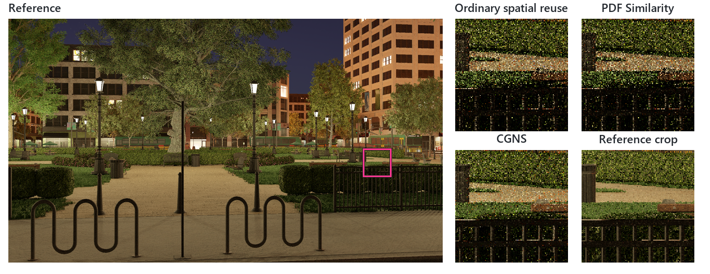
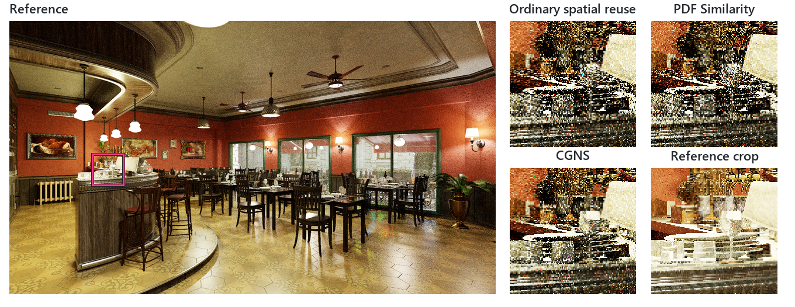
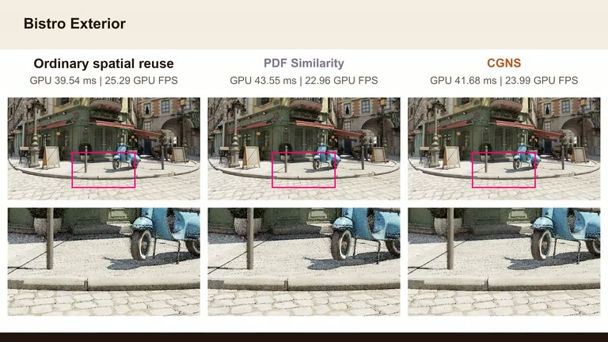

# ReSTIR Spatial Reuse: Implementation and Evaluation

This project reproduces and evaluates selected ReSTIR methods for HKUST COMP5411 Advanced Computer Graphics, taught by [Professor Pedro V. Sander](https://cse.hkust.edu.hk/~psander/).

## ReSTIR PT results

We compare ordinary spatial reuse, PDF Similarity, and CGNS on Falcor 9.0. The box in each reference image marks the region shown in all four crops.

### Emerald Square

### Bistro Interior

### Six-view statistics

All three methods use the same rendering settings at 1080p and 1 spp with temporal reuse enabled. Whole-image SMAPE is averaged over four seeds against 16,384 spp references. [Results and CSVs](results/summaries/falcor-pt-spatial-reuse/README.md) · [Benchmark protocol](docs/reproductions/pt-6-views-spatial-compare.md)

| View            | Ordinary SMAPE (%) | PDF SMAPE (%) | CGNS SMAPE (%) | Ordinary GPU (ms) | PDF GPU (ms) | CGNS GPU (ms) |
| --------------- | --------------------: | ---------------: | ----------------: | -------------------: | --------------: | ---------------: |
| Emerald Square  |                 25.55 |            26.99 |         **19.74** |                    — |               — |                — |
| Bistro Interior |                 28.04 |            28.04 |         **25.30** |                37.28 |           41.33 |            38.85 |
| Bistro Exterior |                 16.67 |            16.32 |         **15.12** |                40.50 |           44.38 |            42.90 |
| Classroom       |                 17.33 |            17.19 |         **16.03** |                32.13 |           40.78 |            33.85 |
| Veach Ajar      |                 16.75 |            16.78 |         **15.89** |                22.53 |           27.22 |            23.42 |
| Zero Day        |                 19.09 |            18.74 |         **18.34** |                69.71 |           75.40 |            72.55 |

### Camera trajectory demos

Each 10-second clip shows three methods on the same camera path. Click either preview to open its MP4. [Trajectory settings](scenes/trajectories/README.md)

|                                                              Bistro Exterior                                                              |                                                Zero Day Measure Seven                                                |
| :---------------------------------------------------------------------------------------------------------------------------------------: | :------------------------------------------------------------------------------------------------------------------: |
|  |  |

## Project guide

RTXDI and Falcor use separate pinned builds. Both write scene-linear images, settings and timings for offline analysis. The RTXDI work includes the [DI baseline](results/summaries/di-baseline/README.md), [PDF Similarity and CGNS experiments](docs/reproductions/rtxdi.md), and a historical DI/GI/PT comparison. The final study compares the three [Falcor PT methods](docs/reproductions/falcor-pt.md).

Start with [setup](docs/setup.md) and the [experiment guides](docs/reproductions/README.md). See the [scene catalogue](scenes/README.md), [experiment suites](experiments/suites/README.md), [experiment protocol](experiments/protocol.md) and [literature guide](docs/literature/README.md) for inputs and context.

| Directory                  | Contents                                            |
| -------------------------- | --------------------------------------------------- |
| `renderers/`               | Pinned RTXDI and Falcor 9.0 submodules              |
| `scenes/`                  | Asset provenance and scene settings                 |
| `experiments/`, `results/` | Configurations and research results                 |
| `scripts/`, `tests/`       | Runners, analysis, and regression tests             |
| `docs/`                    | Setup, experiments, metrics, and literature        |
| `writing/`                 | Course templates, working documents, and references |

Prepare the pinned inputs before running the [six-view Falcor benchmark](docs/reproductions/pt-6-views-spatial-compare.md). [Scene preparation](experiments/configs/falcor-pt-spatial-comparison/PREPARATION.md)

Local assets, builds, and runs are ignored. Edit the [proposal](writing/course/proposal/main.tex) and [report](writing/course/report/main.tex); preserve the [original templates](writing/course/templates/README.md). The [final presentation](writing/final/README.md) includes the three-method PT comparison and trajectory demos. See [contributing](CONTRIBUTING.md), [third-party sources](THIRD_PARTY.md), and [licensing](LICENSE).

See [metrics and saved-result analysis](docs/metrics.md) to inspect an RTXDI or Falcor capture.
